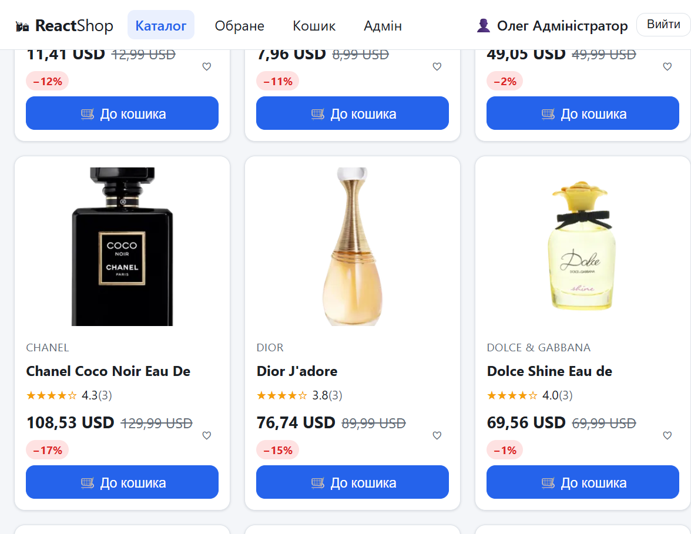
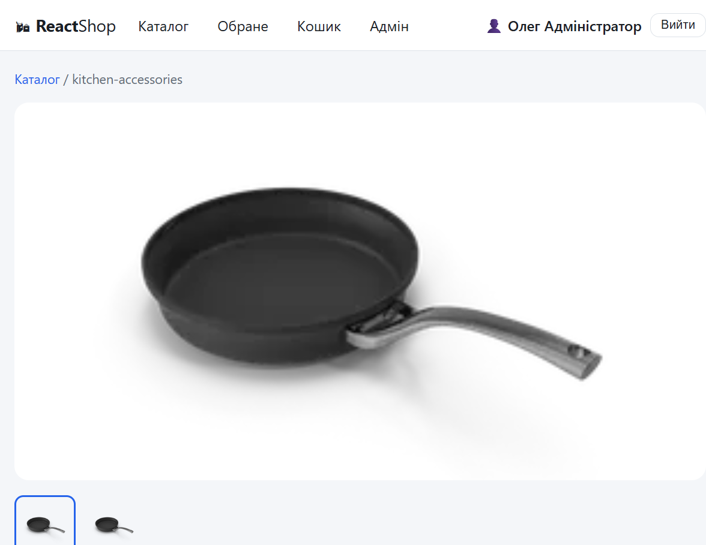
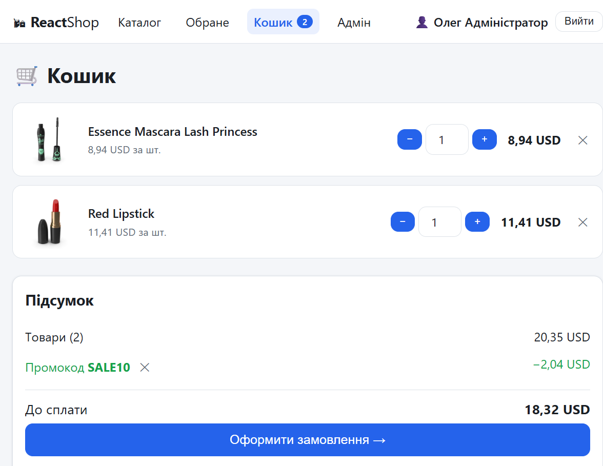
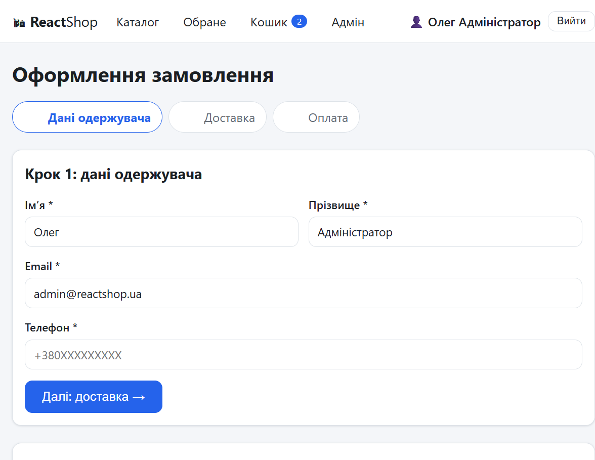
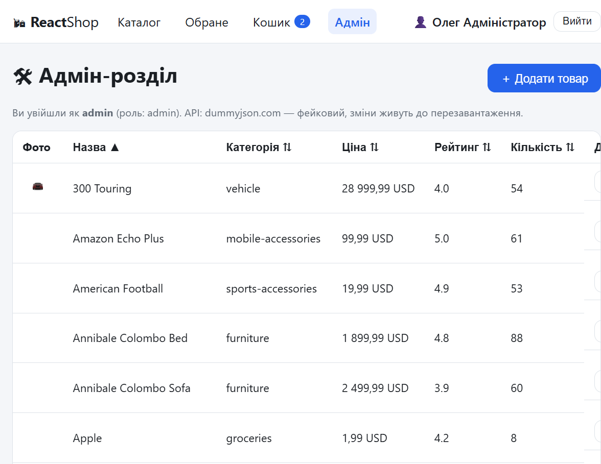

# ReactShop — інтернет-магазин (практична робота №2)

Клієнтська частина інтернет-магазину на **React 19** (React 18+): каталог товарів із фільтрами,
кошик із промокодами, обране, авторизація із захищеними маршрутами, багатокрокове оформлення
замовлення та адмін-розділ. Дані — з відкритого API [dummyjson.com](https://dummyjson.com).

## Можливості

- **Каталог** (`/`): завантаження ~190 товарів з API (кеш RTK Query), пошук із затримкою 300 мс,
  фільтри за категорією, ціною та рейтингом, сортування (ціна/рейтинг/назва), пагінація,
  скелетони завантаження та обробка помилок. Усі фільтри — у query-параметрах URL.
- **Сторінка товару** (`/products/:id`): галерея зображень, характеристики, відгуки,
  кнопка «До кошика», блок «Схожі товари».
- **Кошик** (`/cart`): зміна кількості, підрахунок суми зі знижками товарів,
  промокоди `SALE10`, `SALE20`, `WELCOME5`, лічильник у шапці, збереження в localStorage.
- **Обране** (`/favorites`): додавання/видалення, збереження в localStorage.
- **Авторизація**: вхід/реєстрація (власна імітація сервісу), токен із часом життя,
  захищені маршрути `/profile`, `/checkout`, `/order/:id`, адмін-маршрут за роллю,
  автоматичний вихід після завершення сесії. Демо-акаунти: **admin/admin123** (адмін),
  **user/user123** (клієнт).
- **Оформлення замовлення** (`/checkout`): 3 кроки — дані одержувача → доставка → оплата;
  валідація на кожному кроці (Zod), дані кроків зберігаються в Redux, тому кнопка «назад»
  нічого не втрачає; після підтвердження — сторінка замовлення.
- **Профіль** (`/profile`): редагування даних та історія замовлень.
- **Адмін-розділ** (`/admin`, роль admin): таблиця всіх товарів із сортуванням за стовпцями,
  додавання, редагування та видалення через API-шар (мутації RTK Query).
- **Технічне**: ледаче завантаження маршрутів (`React.lazy` + `Suspense`), `ErrorBoundary`,
  централізований шар API (axios + інтерсептори), адаптивна верстка від 360 px,
  семантичний HTML і `aria-*`.

## Запуск

```bash
npm install          # встановлення залежностей
npm run dev          # dev-сервер: http://localhost:5173
npm test             # тести Vitest (17 тестів)
npm run lint         # ESLint без помилок
npm run build        # продакшн-збірка у dist/
npm run format       # форматування Prettier
```

Адреса API задається у файлі `.env` (`VITE_API_URL=https://dummyjson.com`);
зразок — `.env.example`.

## Архітектура

Код групується за функціональними областями (features): усе, що стосується кошика,
лежить поруч. Стан — Redux Toolkit (зріси + RTK Query для запитів).

```
src/
  app/        store.js (makeStore), hooks.js, router.jsx, Layout.jsx
  shared/
    api/      http.js (axios + інтерсептори), axiosBaseQuery.js, api.js (RTK Query)
    ui/       Skeleton, Pagination, Modal, Rating, ErrorBoundary, RouteError, Spinner
    hooks/    useDebounce.js
    utils/    storage.js, money.js, validation.js (схеми Zod)
  features/
    cart/       cartSlice.js, CartItemRow.jsx
    favorites/  favoritesSlice.js
    auth/       authSlice.js, PrivateRoute.jsx, useAutoLogout.js
    checkout/   checkoutSlice.js, Stepper.jsx, steps/
    orders/     ordersSlice.js
    products/   ProductCard.jsx, Filters.jsx
    admin/      ProductsTable.jsx, ProductForm.jsx
  pages/      ProductsPage, ProductPage, CartPage, FavoritesPage, LoginPage,
              RegisterPage, ProfilePage, CheckoutPage, OrderPage, AdminPage
  test/       setup.js
  main.jsx
```

Ключові рішення:

- **API-шар**: один екземпляр `axios` з інтерсепторами (підставляє токен, нормалізує помилки)
  підключений до RTK Query через власний `axiosBaseQuery`. Каталог кешується, мутації
  адмін-розділу оновлюють кеш через `onQueryStarted` + `updateQueryData`.
- **Зрізи** персистяться в localStorage підпискою на store (`save`), історія замовлень
  та кошик переживають перезавантаження.
- **Форми**: `react-hook-form` + `zodResolver`; схеми валідації винесені в `shared/utils`
  і тестуються окремо від UI.
- **Авторизація**: власна імітація (методичка дозволяє) — користувачі в localStorage,
  токен `base64` з `exp`; `useAutoLogout` ставить таймер на час, що лишився.

## Тести

Vitest + React Testing Library (середовище jsdom), 17 тестів:

- `cartSlice.test.js` — додавання, ліміти кількості, промокоди, селектори сум;
- `validation.test.js` — схеми Zod (вхід, реєстрація, кроки оформлення, товар);
- `money.test.js` — форматування сум і знижки;
- `ProductCard.test.jsx` — рендер, додавання в кошик, перемикач обраного.

## Скриншоти

| Каталог | Товар |
| --- | --- |
|  |  |

| Кошик | Оформлення |
| --- | --- |
|  |  |



## Розгортання

Для Vercel/Netlify потрібен фолбек на `index.html` для SPA-маршрутів — файл `vercel.json`
у корені проєкту вже містить потрібні правила перезапису.
